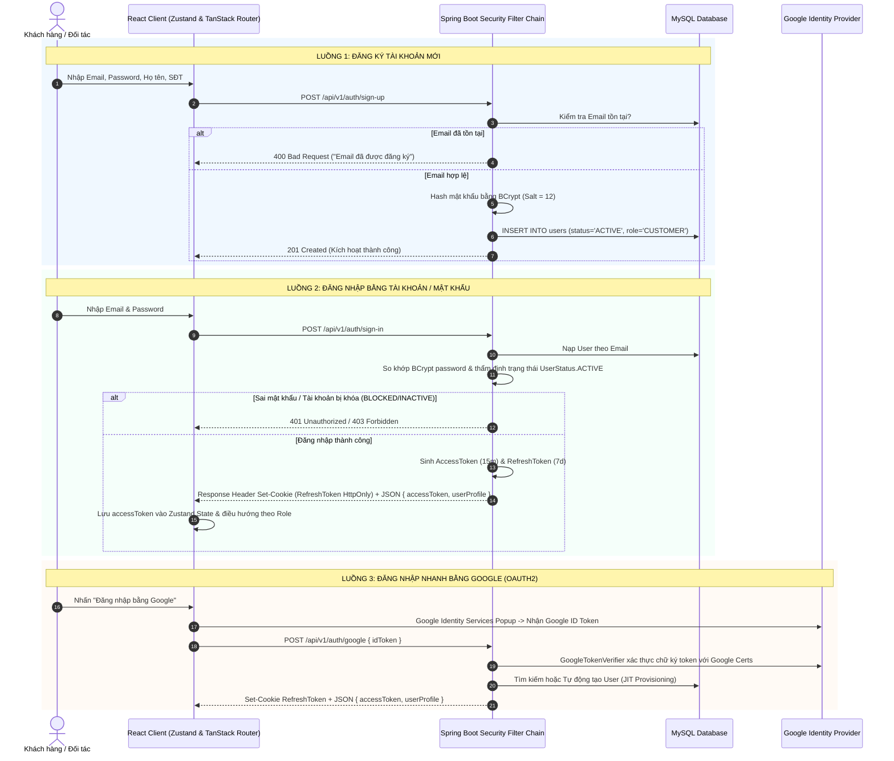
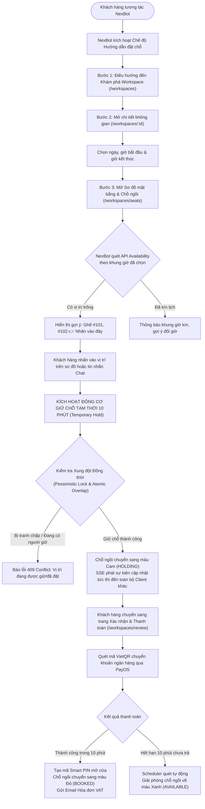
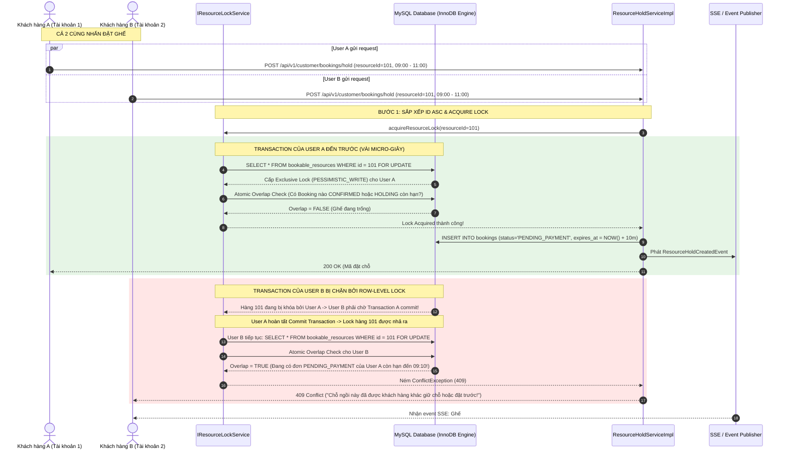
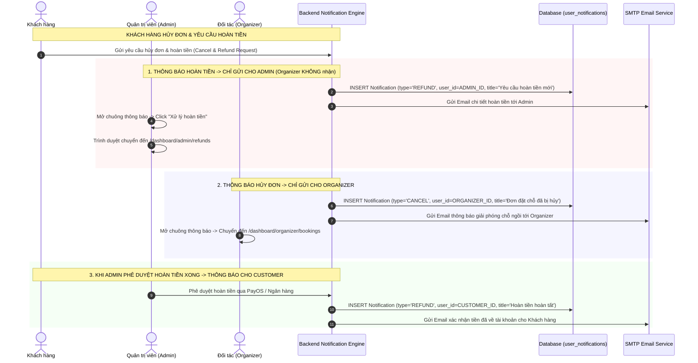

# TÀI LIỆU THUYẾT TRÌNH KIẾN TRÚC & LUỒNG CHỨC NĂNG HỆ THỐNG NEXSPACE
> **Dự án**: Nền Tảng Đặt Chỗ Không Gian Làm Việc Thông Minh (NexSpace Platform)  
> **Phiên bản kiến trúc**: Enterprise Full-Stack (Spring Boot 3.5 & React 19 / TanStack)  
> **Mục đích**: Tài liệu thuyết trình kỹ thuật, giải trình cơ chế vận hành, quy tắc nghiệp vụ, giải pháp phòng vệ đồng thời (Concurrency Defense) và công nghệ áp dụng.

---

## MỤC LỤC THUYẾT TRÌNH
1. [PHẦN 1: Luồng Xác Thực & Phân Quyền (Authentication & Authorization)](#phan-1-luong-xac-thuc--phan-quyen-authentication--authorization)
2. [PHẦN 2: Luồng Trợ Lý AI Chatbot, Đặt Chỗ & Kiểm Soát Đồng Thời (AI Chatbot, Booking & Concurrency Defense)](#phan-2-luong-tro-ly-ai-chatbot-dat-cho--kiem-soat-dong-thoi-ai-chatbot-booking--concurrency-defense)
3. [PHẦN 3: Luồng Hệ Thống Thông Báo Đa Kênh & Cách Ly Dữ Liệu (Multi-Channel Notification System)](#phan-3-luong-he-thong-thong-bao-da-kenh--cach-ly-du-lieu-multi-channel-notification-system)

---

## PHẦN 1: LUỒNG XÁC THỰC & PHÂN QUYỀN (AUTHENTICATION & AUTHORIZATION)

### 1. Tổng quan & Công nghệ sử dụng
* **Backend**: Spring Security 6, JWT (JSON Web Token - HMAC-SHA256), Google OAuth2 Client SDK (`GoogleTokenVerifierService`), BCrypt Password Encoder, Hibernate/JPA.
* **Frontend**: TanStack Router (Route Guards / BeforeLoad redirect), TanStack React Query, Zustand (`useAuthStore`), Session Heartbeat Engine (`useSessionHeartbeat`).
* **Mô hình Token**: 
  * `AccessToken`: Lưu trữ ngắn hạn trong Memory/Zustand State, truyền qua Header `Authorization: Bearer <token>`.
  * `RefreshToken`: Lưu trong HTTP-Only Cookie (`SameSite=Strict`, `Secure`) ngăn ngừa triệt để lỗ hổng XSS.
* **Hệ thống Vai trò (RBAC - Role-Based Access Control)**:
  * `CUSTOMER`: Khách hàng tìm kiếm, đặt chỗ, thanh toán PayOS, gửi review, khiếu nại.
  * `ORGANIZER`: Đối tác chủ không gian, quản lý mặt bằng (Floor AI Studio), quản lý đơn đặt, yêu cầu rút tiền (Payout).
  * `ADMIN`: Quản trị viên tối cao, phê duyệt hồ sơ đối tác, xử lý lệnh hoàn tiền (Refund), điều hành kiểm toán (Audit Log).

---

### 2. Sơ đồ tuần tự: Đăng ký & Đăng nhập (Local & Google OAuth2)



---

### 3. Cơ chế Phân quyền (Authorization) & Bảo mật Session Heartbeat
1. **Bảo vệ Endpoint tại Backend**:
   * Áp dụng cú pháp Spring Security `@PreAuthorize("hasRole('ADMIN')")`, `hasRole('ORGANIZER')`.
   * Bộ lọc `JwtAuthenticationFilter` chặn mọi request đến `/api/v1/*` (trừ các endpoint `/public/**`), trích xuất Claims, nạp `SecurityContextHolder`.
2. **Bảo vệ Route tại Frontend**:
   * Định nghĩa `beforeLoad` trong các File Route của TanStack Router (`/dashboard/admin/*`, `/dashboard/organizer/*`).
   * Nếu người dùng chưa đăng nhập: Tự động lưu `redirect` param và đẩy về `/auth/sign-in`.
   * Nếu sai Role: Tự động chuyển hướng về trang chủ hoặc Role Dashboard tương ứng mà không để lộ màn hình trắng.
3. **Session Heartbeat Engine**:
   * Hook `useSessionHeartbeat` chạy ngầm định kỳ (mỗi 60 giây).
   * Gửi tín hiệu `GET /api/auth/heartbeat`. Khi AccessToken gần hết hạn (dưới 2 phút), hệ thống tự động kích hoạt Endpoint `/api/v1/auth/refresh-token` sử dụng HttpOnly Cookie để tái cấp Token mới trong suốt (Seamless Token Rotation), người dùng không bị văng khỏi phiên làm việc khi đang thao tác.

---

## PHẦN 2: LUỒNG TRỢ LÝ AI CHATBOT, ĐẶT CHỖ & KIỂM SOÁT ĐỒNG THỜI (AI CHATBOT, BOOKING & CONCURRENCY DEFENSE)

### 1. Kiến trúc Trợ lý Thông minh NexBot
* **Công nghệ cốt lõi**: Google Gemini 2.5 Flash, HTTP REST API, Spring Boot Service layer, TanStack Router.
* **Bộ lọc ngôn từ (Profanity Filter)**: In-Memory Cache lưu trữ 39 từ khóa cấm, tự động chặn tin nhắn thô tục trước khi gửi đến LLM.
* **Fail-Safe Fallback Engine**: Nếu mất kết nối AI hoặc hết quota, bộ xử lý 12 nhóm ý định (Intent Buckets) dựa trên tập luật và JPA Database sẽ tự động phản hồi ngay lập tức với độ trễ < 50ms.
* **Trợ lý đặt chỗ theo ngữ cảnh (Contextual Guided Booking Assistant)**:
  * NexBot tự động lắng nghe URL Pathname và Search Params của người dùng.
  * Tự động hiển thị tin nhắn hướng dẫn phù hợp với từng bước:
    * `/` (Trang chủ) $\rightarrow$ Hướng dẫn khám phá danh sách không gian kèm liên kết rút gọn.
    * `/workspaces` $\rightarrow$ Hướng dẫn chọn lọc quận/giá và xem chi tiết.
    * `/workspaces/:id` $\rightarrow$ Hướng dẫn chọn ngày, giờ bắt đầu - kết thúc ở khung lịch.
    * `/workspaces/seats` $\rightarrow$ Tự động gọi API `/public/workspaces/{id}/availability`, phân tích các vị trí bàn ghế/phòng trống theo đúng khung giờ đã chọn và cung cấp link chọn vị trí.
* **Bộ phân tích cú pháp liên kết ngắn (Concise Markdown Link Parser)**:
  * Tách biệt Markdown Link trước định dạng Bold, triệt tiêu lỗi nuốt link markdown cũ.
  * Rút gọn toàn bộ liên kết dài dòng thành nhãn duy nhất: **`[Nhấn vào đây]`** hoặc **`[Tại đây]`**.
  * Chặn Reload trang bằng `router.navigate`, chuyển đổi giữa các phòng bàn mượt mà (Zero Reload SPA Navigation).

---

### 2. Sơ đồ tổng thể: Từ NexBot đến Sơ đồ mặt bằng & Thanh toán



---

### 3. Cơ chế Xử lý Xung đột Đồng thời (Concurrency & Double Booking Defense)

> [!IMPORTANT]
> **Vấn đề cốt tử**: Điều gì xảy ra khi 2 tài khoản $A$ và $B$ cùng nhấn nút đặt chỗ vào **cùng 1 chiếc ghế tại cùng 1 mili-giây**? Hoặc một người đặt **Phòng họp (Meeting Room)** trong khi người kia đang đặt **Chiếc bàn con (Focus Desk)** nằm bên trong phòng đó?

Hệ thống NexSpace triển khai kiến trúc phòng vệ đa tầng tiêu chuẩn Enterprise:



#### Chi tiết 5 quy tắc an toàn trong phòng vệ đặt chỗ:
1. **Giao thức khóa thứ tự chống Deadlock (Deadlock-Free Lock Ordering)**:
   * Khi khóa nhiều tài nguyên liên quan, mã nguồn luôn sắp xếp danh sách ID theo thứ tự tăng dần (`idsToLock.stream().sorted().toList()`).
   * Triệt tiêu 100% hiện tượng deadlock vòng tròn (Deadlock Cycle) giữa các thread đồng thời.
2. **Khóa loại trừ hai chiều Phân cấp Phòng - Ghế (Hierarchical ROOM - DESK Mutual Exclusion)**:
   * Nếu người dùng chọn đặt **Phòng họp (ROOM)**: Hệ thống tự động truy vấn và khóa luôn toàn bộ các **Bàn con (DESKS)** nằm trong phòng đó.
   * Nếu người dùng chọn đặt **Bàn con (DESK)**: Hệ thống tự động khóa luôn cả **Phòng cha (PARENT ROOM)**.
   * Ngăn chặn tuyệt đối trường hợp một nhóm khách họp phòng lớn nhưng bên trong lại có khách lẻ ngồi làm việc.
3. **Cơ chế Idempotent Active Hold Reuse**:
   * Nếu cùng 1 khách hàng nhấn nhiều lần vào cùng 1 chỗ ngồi trong khung giờ còn hiệu lực, hệ thống nhận diện và trả về phiên giữ chỗ hiện tại, không phát sinh lỗi 409 vô lý và không tạo rác dữ liệu.
4. **Phòng vệ Spam Hold & Tấn công gom chỗ (Anti-Hoarding & Anti-DoS)**:
   * **Giới hạn số chỗ**: Mỗi tài khoản chỉ được giữ tối đa **3 chỗ đồng thời**.
   * **Phòng vệ giữ chỗ liên tục (Re-hold Churning Defense)**: Sau khi hủy hoặc để hết hạn 1 chỗ, tài khoản bị cooldown 30 giây trước khi được giữ lại vị trí đó.
   * **Khóa tài khoản tự động**: Khách hàng spam hủy/bỏ phiên giữ chỗ quá 3 lần trong ngày sẽ bị hệ thống tự động đình chỉ quyền đặt chỗ trong 20 phút (`bookingSuspendedUntil`).
5. **Đồng bộ hóa thời gian thực (SSE Availability Stream)**:
   * Tích hợp Server-Sent Events (`/api/v1/workspaces/{id}/availability/stream`).
   * Ngay khi sự kiện giữ chỗ hoặc thanh toán hoàn tất, toàn bộ các trình duyệt đang xem sơ đồ mặt bằng đều cập nhật trạng thái màu ghế ngay lập tức mà không cần F5 tải lại trang.

---

## PHẦN 3: LUỒNG HỆ THỐNG THÔNG BÁO ĐA KÊNH & CÁCH LY DỮ LIỆU (MULTI-CHANNEL NOTIFICATION SYSTEM)

### 1. Phân loại & Phân luồng Nghiệp Vụ Nghiêm Ngặt
Hệ thống thiết lập ma trận phân định quyền nhận thông báo rõ ràng nhằm bảo vệ tính bảo mật và không làm loãng thông tin của các vai trò:

| Loại Thông Báo (`NotificationType`) | Đối Tượng Nhận | Không Gửi Cho | Hành Động Khi Click (SPA Routing) | Kênh Gửi |
| :--- | :--- | :--- | :--- | :--- |
| **Yêu cầu Hoàn tiền (`REFUND`)** | **Chỉ gửi ADMIN** | **Không gửi Organizer** | Chuyển thẳng đến màn hình duyệt hoàn tiền: `/dashboard/admin/refunds` | In-App + Email Admin |
| **Hủy đơn đặt chỗ (`CANCEL`)** | **Gửi ORGANIZER** | Không gửi Admin | Chuyển đến quản lý đơn đặt của cơ sở: `/dashboard/organizer/bookings` | In-App + Email Organizer |
| **Đánh giá không gian (`WORKSPACE_REVIEW`)** | **Gửi ORGANIZER** | Không gửi Admin | Chuyển đến trang chi tiết cơ sở: `/dashboard/organizer/workspaces` | In-App |
| **Khiếu nại khách hàng (`COMPLAINT`)** | **Gửi ORGANIZER** | Không gửi Admin | Chuyển đến màn hình hỗ trợ/đơn hàng: `/dashboard/organizer/bookings` | In-App |
| **Xác nhận đặt chỗ & Smart PIN (`BOOKING`)** | **Khách hàng (CUSTOMER)** | Admin / Khác | Chuyển đến lịch sử vé cá nhân: `/workspaces/my-bookings` | In-App + Email (Smart PIN) |
| **Thanh toán PayOS thành công (`PAYMENT`)** | **Khách hàng (CUSTOMER)** | Organizer | Chuyển đến chi tiết giao dịch: `/workspaces/my-bookings` | In-App + Email Hóa đơn VAT |
| **Hồ sơ Đối tác (`ORGANIZER_APPLICATION`)** | **ADMIN & Ứng viên** | - | Admin duyệt hồ sơ: `/dashboard/organizer/application` | In-App + Email |

---

### 2. Quy Tắc Sắp Xếp & Độc Lập Tài Khoản (Account Isolation)
1. **Ưu tiên thông báo chưa đọc lên đầu (Unread-First Ordering)**:
   * **Cấp Database (JPQL Repository)**:
     ```sql
     SELECT n FROM UserNotificationModel n 
     WHERE n.user.id = :userId 
     ORDER BY n.read ASC, n.createdAt DESC
     ```
     * Các thông báo chưa xem (`read = false`) luôn nằm ở nhóm trên cùng.
     * Trong từng nhóm, thông báo mới nhất xếp trước (`createdAt DESC`).
   * **Cấp Frontend (React `useMemo`)**:
     * Client-side sort đồng bộ:
       ```typescript
       return [...raw].sort((a, b) => {
         if (a.read !== b.read) return a.read ? 1 : -1;
         return new Date(b.createdAt).getTime() - new Date(a.createdAt).getTime();
       });
       ```
2. **Cách ly bộ nhớ đệm (Query Cache Isolation)**:
   * Query Keys trong TanStack React Query được gán kèm `userId`:
     ```typescript
     queryKey: ['notifications', 'customer', userId, page, size]
     queryKey: ['notifications', 'customer', userId, 'unread-count']
     ```
   * Khi đăng xuất tài khoản A và đăng nhập tài khoản B trên cùng trình duyệt, toàn bộ cache cũ được hủy (`queryClient.invalidateQueries`), triệt tiêu 100% tình trạng hiển thị nhầm thông báo giữa các tài khoản.

---

### 3. Sơ đồ luồng Thông báo & Xử lý Hoàn tiền



---

## TỔNG KẾT BẢNG CÔNG NGHỆ CHÍNH ÁP DỤNG TRONG TOÀN BỘ HỆ THỐNG

| Module | Công nghệ / Framework | Vai trò / Mục đích |
| :--- | :--- | :--- |
| **Backend Core** | Spring Boot 3.5, Java 17 | Nền tảng Micro-monolith API hiệu năng cao |
| **Bảo mật** | Spring Security 6, JWT, Google OAuth2 SDK | Xác thực không lưu trạng thái (Stateless), bảo vệ phiên HttpOnly Cookie |
| **Database & ORM** | MySQL 8.0, Hibernate 6, Spring Data JPA, Flyway | Quản lý schema versioning và khóa bi quan PESSIMISTIC_WRITE |
| **Concurrency Defense** | `PESSIMISTIC_WRITE`, ID ASC Ordering, Atomic Overlap Queries | Chống đặt trùng ghế (Double Booking), chống Deadlock tuyệt đối |
| **Realtime Sync** | Server-Sent Events (SSE), Spring Application Events | Đẩy trạng thái ghế xanh/cam/đỏ tức thì tới người dùng |
| **Trí tuệ nhân tạo (AI)** | Google Gemini 2.5 Flash REST API | Trợ lý tư vấn, lập sơ đồ mặt bằng Floor AI Studio |
| **Thanh toán** | PayOS SDK (VietQR, Napas 24/7) | Cổng thanh toán quốc gia, đối soát tự động, Webhook bảo mật |
| **Frontend Framework** | TanStack Start, React 19, Vite, Tailwind CSS v4 | Server-side rendering, giao diện phản hồi tức thì |
| **State & Navigation** | TanStack Router, TanStack Query, Zustand | Điều hướng SPA không reload, quản lý cache độc lập tài khoản |
